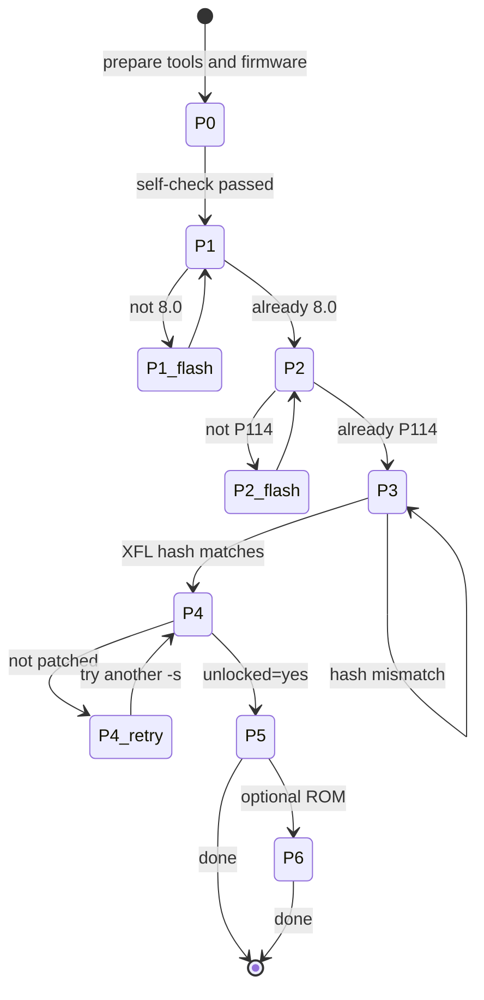

# AI-GUIDE · Executable state machine

[中文](AI-GUIDE.md) | **English**

> This file is for **AI agents / automation**.
> Every phase has: preconditions → commands → success criteria → failure branches.
> Execute strictly in order. **If a criterion is not met, do not advance.**

---

## Machine-readable spec

```yaml
target:
  model: Sony Xperia XZ1 Compact (SO-02K, docomo)
  codename: lilac
  soc: MSM8998
  required_rom: Android 8.0.0 / build 47.1.F.1.105
  required_bootloader: "1306-5035_X_Boot_MSM8998_LA2.0_P_114"

workspace:
  env: KIT
  layout:
    tools: "${KIT}/tools"
    firmware: "${KIT}/firmware"
    backup: "${KIT}/backup"

constants:
  xfl_blob_size: 13153250
  xfl_blob_sha256: c745a32721d68bb7499a0e929bd9bcfec307cb922d0c17c22f064a51e6e1a7c7
  xperable_size_default: "0xf69880"
  xperable_size_fallback: ["0xf49880","0xf59880","0xf79880","0xf89880","0xf99880"]

phases:
  - id: P0
    name: env-check
    cmd: "bash scripts/check_prereqs.sh"
    success: "exit code 0"
    on_fail: "see DOWNLOADS.md"

  - id: P1
    name: verify-rom
    cmd: "adb shell getprop ro.build.id"
    success: "== 47.1.F.1.105"
    on_fail: "flash docomo 8.0 (newflasher, answer n to all prompts)"

  - id: P2
    name: p114-bootloader
    cmd: "fastboot getvar version-bootloader"
    success: "contains P_114"
    on_fail: "flash p114 package; pick ABL variant matching bootdelivery (5ADA|5D31|C93B)"

  - id: P3
    name: temp-root-and-xfl
    cmd: "adb push bindershell; ./bindershell; dd xfl-o77.mbn -> /dev/block/bootdevice/by-name/xfl"
    success: "sha256 of first 13153250 bytes == xfl_blob_sha256"
    on_fail: "re-push, re-dd; verify the source file hash"

  - id: P4
    name: unlock
    cmd: "xperable -v -V -B -U -s 0xf69880 -5 && xperable -v -V -c \"oem unlock Y\" -1 && xperable -v -V -c reboot -1"
    success: "'patched successfully' then 'OKAY', and after reboot: unlocked == yes"
    hard_rule: "NO reboot / NO unplug / NO other fastboot cmd between patch and unlock"
    on_fail: "iterate -s values (see §7); never skip the success check"

  - id: P5
    name: magisk
    cmd: "boot_patch.sh boot.img && fastboot flash boot new-boot.img"
    success: "adb shell magisk -v returns a version; pidof magiskd non-empty"
    on_fail: "re-extract binaries from the same APK; roll back boot"

  - id: P6
    name: lineageos
    optional: true
    cmd: "fastboot boot recovery.img && adb sideload rom.zip (then format data)"
    success: "ro.lineage.version non-empty"
    on_fail: "must sideload from Lineage recovery, not stock (E3004)"

stop_conditions:
  - "newflasher prints flash:bootloader FAILED"
  - "device manager shows QUSB_BULK or 9008 (EDL)"
  - "two consecutive P114 flashes fail with different errors"
  - "three consecutive FAILCommand not allowed on oem unlock"
  - "user asks to relock the bootloader"
```

**State flow**



---

## 0. Rules (read first)

```
R1  Run the preconditions before every state transition. Never assume the previous step worked.
R2  Before any fastboot operation, confirm `fastboot devices` shows a device.
R3  Before any flash-mode operation, confirm the device manager shows SOMC Flash Device.
R4  Between a successful exploit (P4.2) and `oem unlock Y` (P4.3):
    no reboot, no unplug, no other fastboot command.
R5  If any SHA256 check fails, go back to the corresponding write step. Do not continue.
R6  On any STOP condition (§8), stop immediately and report. Do not try to "fix" it.
R7  After each phase, log: phase id, key output, timestamp.
```

Variables:

```bash
KIT=${KIT:-$HOME/sony-kit}
ADB="$KIT/tools/platform-tools/adb"
FB="$KIT/tools/platform-tools/fastboot"
```

---

## Phase 0 · Environment self-check

**Goal**: toolchain present, device reachable.

```bash
bash scripts/check_prereqs.sh
$ADB devices
```

**Success**: exit code 0, and `adb devices` lists a device with state `device`.

**Failure**

| Symptom | Action |
|---|---|
| `unauthorized` | ask the user to tap "Allow USB debugging" |
| no output | check drivers (docs/en/01) |
| missing file / hash mismatch | re-download, see DOWNLOADS |

---

## Phase 1 · Verify the ROM (downgrade if needed)

```bash
$ADB shell getprop ro.build.version.release   # expect 8.0.0
$ADB shell getprop ro.build.id                # expect 47.1.F.1.105
$ADB shell getprop ro.product.device          # expect lilac
```

**Success**: all three match.

**Failure**: flash docomo 8.0 per `docs/en/02` §2.1 (newflasher, answer `n` to all four prompts),
then re-run this phase.

---

## Phase 2 · Flash the P114 bootloader

```bash
# power off -> hold Vol UP -> plug USB (blue LED)
$FB devices
$FB getvar version-bootloader
```

If it already contains `LA2.0_P_114`, **skip this phase**.

Otherwise:

```bash
# power off -> hold Vol DOWN -> plug USB (green LED)
cd "$KIT/firmware/p114"
"$KIT/tools/newflasher.x64"      # answer n to every prompt
# boot up, then re-enter fastboot and verify
$FB getvar version-bootloader
```

**Success**: output contains `1306-5035_X_Boot_MSM8998_LA2.0_P_114`.

**Failure**

| Symptom | Action |
|---|---|
| bootloader rejected / delivery mismatch | switch ABL variant (5ADA / 5D31 / C93B), see docs/en/02 §2.2 |
| newflasher cannot see device | driver missing (docs/en/01 §1.1C) |

---

## Phase 3 · Temporary root + write the O77 XFL

### 3.1 Get temporary root

```bash
$ADB push "$KIT/tools/bindershell/bindershell" /data/local/tmp/
$ADB shell "cd /data/local/tmp && chmod 755 ./bindershell && ./bindershell"
```

**Success**: `got root, start shell...` and the prompt becomes `#`.

### 3.2 Back up the original partitions (mandatory)

```sh
dd if=/dev/block/bootdevice/by-name/xfl of=/sdcard/xfl-current.img
dd if=/dev/block/bootdevice/by-name/abl of=/sdcard/abl-current.img
```
```bash
$ADB pull /sdcard/xfl-current.img "$KIT/backup/"
$ADB pull /sdcard/abl-current.img "$KIT/backup/"
```

**Success**: `xfl-current.img` is `31,457,280` bytes.

### 3.3 Write and verify

```bash
$ADB push "$KIT/tools/xfl-o77.mbn" /sdcard/
```
```sh
# inside the root shell
dd if=/sdcard/xfl-o77.mbn of=/dev/block/bootdevice/by-name/xfl
sync
dd if=/dev/block/bootdevice/by-name/xfl of=/sdcard/xfl_head.bin bs=1024 count=12845
sha256sum /sdcard/xfl-o77.mbn /sdcard/xfl_head.bin
```

**Success**: both hashes equal
`c745a32721d68bb7499a0e929bd9bcfec307cb922d0c17c22f064a51e6e1a7c7`

**Failure**

| Symptom | Action |
|---|---|
| prompt is still `$` | bindershell did not escalate; retry 3.1 |
| hash mismatch | re-push and re-dd; never use `cp` |
| `Permission denied` | not in a root shell |

---

## Phase 4 · xperable patch + unlock

**Goal**: `unlocked: yes`.

### 4.1 Enter fastboot

Power off → hold Vol UP → plug USB (blue LED).

```bash
$FB devices
```

### 4.2 Patch

```bash
cd "$KIT/tools/xperable"
./xperable.exe -v -V -B -U -s 0xf69880 -5      # Windows
# ./xperable -v -V -B -U -s 0xf69880 -5        # Linux
```

**Success** (both lines required):

```
[+] Got LinuxLoader base addr 0x........
[+] LinuxLoader @ 0x........ patched successfully
```

**Failure**: see §7 for other `-s` values. Do **not** run 4.3 after a failed patch.

### 4.3 Unlock immediately (nothing else in between)

```bash
./xperable.exe -v -V -c "oem unlock Y" -1
```

**Success**: `{...<-00000004:OK} "OKAY"`.

### 4.4 Reboot

```bash
./xperable.exe -v -V -c reboot -1
```

### 4.5 Verify

```bash
$FB getvar unlocked                            # expect: unlocked: yes
$ADB shell getprop ro.boot.verifiedbootstate   # expect: orange
$ADB shell getprop ro.boot.flash.locked        # expect: 0
```

**Failure**

| Symptom | Action |
|---|---|
| `unlocked: no` | unlock did not take; redo 4.2 (you may need to re-enter fastboot) |
| boot loop / stuck at splash | `/data` cannot decrypt → `$FB -w` or reflash (docs/en/07 §2) |

---

## Phase 5 · Magisk root

### 5.1 Obtain boot.img

- Stock 8.0: your own backup, or extract from `firmware/docomo-8.0/kernel.sin`
- LineageOS: `unzip lineage-*.zip boot.img`

### 5.2 Patch (Linux/WSL)

```bash
cd "$KIT/tools/magisk-patch"
cp /path/to/boot.img .
sh boot_patch.sh boot.img
# output: new-boot.img
```

### 5.3 Flash

```bash
$FB flash boot "$KIT/tools/magisk-patch/new-boot.img"
$FB reboot
```

### 5.4 Verify

```bash
$ADB install -r "$KIT/tools/Magisk-v31.1.apk"
$ADB shell "magisk -v"          # e.g. 31.1
$ADB shell "pidof magiskd"      # non-empty
```

**Known**: since Magisk 31, `adb shell su` is denied (`request rejected (2000)`).
That is by design and does not mean root failed. Verify through the Magisk app instead.

---

## Phase 6 (optional) · LineageOS

```bash
$FB boot "$KIT/firmware/lineage/lineage-*-recovery-lilac.img"
# in recovery: Apply update -> Apply from ADB
$ADB sideload "$KIT/firmware/lineage/lineage-*-lilac.zip"
# in recovery: Format data / Factory reset
```

**Success**
- `$ADB shell getprop ro.lineage.version` is non-empty
- `$ADB shell dumpsys nfc | grep conf` shows `libnfc-nci-cxd224x.conf`
- boot was overwritten by the ROM → **redo Phase 5**

> Do **not** `fastboot boot` TWRP: on this model it hangs at the white Sony logo.
> Do **not** sideload from stock recovery: it fails with `E3004`.

---

## 7. `-s` sweep list

Try in order, stop on the first hit:

```
0xf49880  0xf59880  0xf69880*  0xf79880  0xf89880  0xf99880**
0xfa9880  0xfb9880  0xfc9880  0xfd9880  0xfe9880
```

`*` verified on the reference unit　`**` verified on another SO-02K (XDA)

Finer steps (0x20000 apart):

```
0xf63880 0xf65880 0xf67880 0xf69880 0xf6b880 0xf6d880 0xf6f880
```

Script:

```powershell
pwsh scripts/sweep_xperable.ps1 -Kit "C:\sony-kit"
```

Before each attempt, confirm the device is still in fastboot. If it dropped out,
re-enter: power off → hold Vol UP → plug USB.

---

## 8. STOP conditions

Stop and report if any of these happen. Do not attempt repairs on your own:

1. `newflasher` prints `flash:bootloader FAILED`
2. Device manager shows `QUSB_BULK` or `9008` (EDL mode)
3. Two consecutive P114 flash attempts fail with different errors
4. Three consecutive `FAILCommand not allowed` on `oem unlock`
5. The user asks to relock the bootloader (`fastboot oem lock`) — see docs/en/08 §8.5

---

## 9. Progress log format

Append one line per phase:

```
[phase] [timestamp] [result] [key output]
P3.3    2026-11-03T02:11  OK   sha256 c745a327... matches
```

On failure:

```
P4.2    2026-11-03T02:20  FAIL -s=0xf3f880 -> immediate exit after "OKAY", no "patched" line
```
